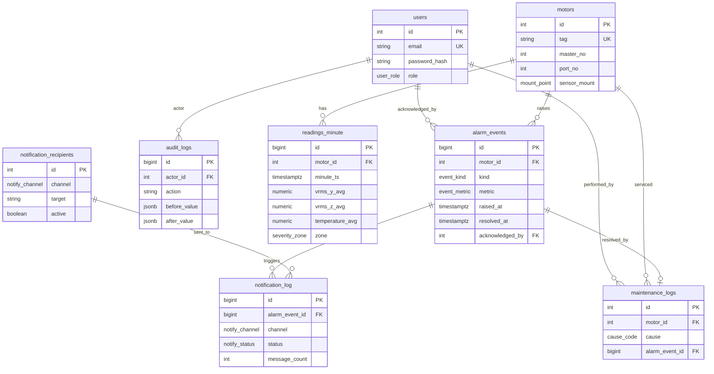

# Phase 3 — Database Design
## GS Battery · CMTK Condition Monitoring

| | |
|---|---|
| Document ID | DB-CMTK-001 |
| Version | 1.0 (โครง — รอปิด blocker แล้วยืนยันตัวเลข) |
| อ้างอิง | REQ-CMTK-001 v0.3 · DSN-CMTK-001 v1.0 · SOP `03_DATABASE` |
| Status | 🟡 รอ senior review |

---

## 1. Database Overview

```yaml
Database Name: cmtk_monitoring
Engine: PostgreSQL 16 (linux/arm64)
Character Set: UTF-8
Collation: en_US.UTF-8
Timezone: UTC (จัดเก็บ) · Asia/Bangkok (แสดงผล)
Total Tables: 8
Total Enums: 7
Schema Version: 1.0.0
Deployment: container บนบอร์ด CMTK · PGDATA บน /mnt/sdcard
```

**ข้อจำกัดฮาร์ดแวร์ที่กำหนดการออกแบบ**

| | |
|---|---|
| พื้นที่ | SD card 28.8 GB เหลือ 27 GB |
| RAM | 3.9 GB · ว่าง 2.9 GB |
| ปริมาณเขียน | 4 sensor × 1 แถว/นาที = 5,760 แถว/วัน ≈ 2.1 ล้านแถว/ปี |
| งบพื้นที่ | **เพดาน 5 GB** — เหลือที่ว่างให้ CMTK และ InfluxDB |

**การตั้งค่าที่บังคับ** — SD card สึกจากการเขียน ไม่ใช่จากพื้นที่เต็ม

```
synchronous_commit = off      # ยอมเสียข้อมูลไม่เกิน 1 รอบ checkpoint แลกอายุการ์ด
wal_compression = on
checkpoint_timeout = 15min
shared_buffers = 512MB
```

---

## 2. ERD



---

## 3. Enums

```sql
CREATE TYPE user_role      AS ENUM ('maintenance', 'manager', 'admin');
CREATE TYPE severity_zone  AS ENUM ('A', 'B', 'C', 'D');
CREATE TYPE event_kind     AS ENUM ('alarm', 'warning', 'zone_change', 'offline');
CREATE TYPE event_metric   AS ENUM ('vibration', 'temperature', 'connectivity');
CREATE TYPE cause_code     AS ENUM ('bearing', 'misalignment', 'imbalance',
                                    'looseness', 'lubrication', 'other');
CREATE TYPE mount_point    AS ENUM ('DE-H', 'DE-V', 'DE-A', 'NDE-H', 'NDE-V');
CREATE TYPE notify_channel AS ENUM ('line', 'email');
CREATE TYPE notify_status  AS ENUM ('sent', 'failed',
                                    'suppressed_debounce',   -- ติด debounce
                                    'suppressed_daily_cap',  -- เกินเพดานต่อวัน
                                    'suppressed_quota');     -- เกินเพดานเดือน
```

> `cause_code` เป็น enum ไม่ใช่ text — บังคับให้เลือกจากรายการ เพราะถ้าปล่อยให้พิมพ์อิสระ
> 18 เดือนข้างหน้าจะได้ข้อมูลที่ train โมเดลไม่ได้ (§7 ของ REQ-CMTK-001)

---

## 4. Table Definitions

### 4.1 users

```sql
CREATE TABLE users (
    id            SERIAL PRIMARY KEY,
    email         VARCHAR(255) NOT NULL UNIQUE,
    password_hash VARCHAR(255) NOT NULL,       -- bcrypt saltRounds 10
    display_name  VARCHAR(100) NOT NULL,
    role          user_role    NOT NULL DEFAULT 'maintenance',
    is_active     BOOLEAN      NOT NULL DEFAULT TRUE,
    last_login_at TIMESTAMPTZ,
    created_at    TIMESTAMPTZ  NOT NULL DEFAULT NOW(),
    updated_at    TIMESTAMPTZ  NOT NULL DEFAULT NOW()
);

CREATE INDEX idx_users_email ON users (email) WHERE is_active;
```

| Column | ความหมาย |
|---|---|
| `role` | กำหนดสิทธิ์ผ่าน `authorize()` — manager อ่านอย่างเดียว |
| `is_active` | ปิดบัญชีแบบไม่ลบ เพื่อให้ประวัติที่อ้างถึงยังอ่านได้ |

---

### 4.2 motors

```sql
CREATE TABLE motors (
    id                  SERIAL PRIMARY KEY,
    tag                 VARCHAR(32)  NOT NULL UNIQUE,   -- P-101
    name                VARCHAR(120) NOT NULL,
    master_no           SMALLINT     NOT NULL,          -- 1 = CMTK, 2 = BNI XG5-508
    port_no             SMALLINT     NOT NULL,          -- 0–7
    rated_kw            NUMERIC(6,2),
    iso_group           SMALLINT,                       -- ISO 10816-3 กลุ่ม 1/2
    mounting_rigid      BOOLEAN      NOT NULL DEFAULT TRUE,
    sensor_mount        mount_point  NOT NULL DEFAULT 'DE-H',
    sensor_mount_offset JSONB,                          -- [x,y,z] ที่ลากปรับบนโมเดล 3D
    warning_threshold   NUMERIC(6,3) NOT NULL DEFAULT 2.800,
    alarm_threshold     NUMERIC(6,3) NOT NULL DEFAULT 4.500,
    run_hours           NUMERIC(10,2) NOT NULL DEFAULT 0,
    run_hours_reset_at  TIMESTAMPTZ,
    last_seen_at        TIMESTAMPTZ,                    -- ใช้ตรวจ stale (AC-011-03)
    is_active           BOOLEAN      NOT NULL DEFAULT TRUE,
    created_at          TIMESTAMPTZ  NOT NULL DEFAULT NOW(),
    updated_at          TIMESTAMPTZ  NOT NULL DEFAULT NOW(),

    CONSTRAINT uq_motor_port   UNIQUE (master_no, port_no),   -- AC-003-02 → 409
    CONSTRAINT ck_threshold    CHECK (warning_threshold < alarm_threshold),
    CONSTRAINT ck_port         CHECK (port_no BETWEEN 0 AND 7)
);
```

| Column | หมายเหตุ |
|---|---|
| `uq_motor_port` | หนึ่งพอร์ตผูกได้มอเตอร์เดียว — API ต้องแปลง unique violation เป็น **409** |
| `iso_group`, `mounting_rigid` | ใช้ตั้งพารามิเตอร์ให้เซ็นเซอร์คำนวณโซนถูก (B-7 ยังค้าง) |
| `warning/alarm_threshold` | เกณฑ์ฝั่งเราสำหรับกราฟและเส้นทำนาย **ไม่ใช่** เกณฑ์ในเซ็นเซอร์ |
| `last_seen_at` | ingestion อัปเดตทุกครั้งที่รับข้อความ ใช้จับ stale เพราะ QoS 0 ทำให้ event หายได้ |

---

### 4.3 readings_minute

**ตารางที่โตที่สุด** — 1 แถวต่อมอเตอร์ต่อนาที ไม่เก็บดิบ 0.5 วินาที

```sql
CREATE TABLE readings_minute (
    id              BIGSERIAL PRIMARY KEY,
    motor_id        INTEGER     NOT NULL REFERENCES motors(id),
    minute_ts       TIMESTAMPTZ NOT NULL,          -- ตัดลงนาที

    vrms_y_min      NUMERIC(7,3),
    vrms_y_avg      NUMERIC(7,3),
    vrms_y_max      NUMERIC(7,3),
    vrms_z_min      NUMERIC(7,3),
    vrms_z_avg      NUMERIC(7,3),
    vrms_z_max      NUMERIC(7,3),
    temperature_min NUMERIC(6,2),
    temperature_avg NUMERIC(6,2),
    temperature_max NUMERIC(6,2),

    zone            severity_zone,                 -- โซนที่พบบ่อยที่สุดในนาทีนั้น
    sample_count    SMALLINT    NOT NULL,          -- ควรได้ 120 ที่ 0.5 วิ
    invalid_count   SMALLINT    NOT NULL DEFAULT 0,-- isValid = false

    created_at      TIMESTAMPTZ NOT NULL DEFAULT NOW(),

    CONSTRAINT uq_reading UNIQUE (motor_id, minute_ts)   -- เขียนซ้ำไม่เกิดแถวซ้ำ
);

CREATE INDEX idx_readings_motor_time ON readings_minute (motor_id, minute_ts DESC);
CREATE INDEX idx_readings_time       ON readings_minute (minute_ts DESC);
```

**`sample_count` คือเครื่องมือวัดคุณภาพข้อมูล** — MQTT เป็น QoS 0 ข้อความหายได้
ถ้าค่านี้ต่ำกว่า 120 มากแปลว่าข้อมูลขาด ต้องแสดงบน UI ไม่ใช่ทำเป็นว่าเส้นต่อเนื่อง (NFR-05)

**ประมาณการขนาด** — ~140 bytes/แถว × 2.1 ล้านแถว/ปี ≈ **300 MB/ปี รวม index**
ที่เพดาน 5 GB รองรับได้เกิน 10 ปี ข้อจำกัดจริงคืออายุ SD card ไม่ใช่พื้นที่

---

### 4.4 alarm_events

```sql
CREATE TABLE alarm_events (
    id               BIGSERIAL PRIMARY KEY,
    motor_id         INTEGER      NOT NULL REFERENCES motors(id),
    kind             event_kind   NOT NULL,
    metric           event_metric NOT NULL,

    raised_at        TIMESTAMPTZ  NOT NULL,
    resolved_at      TIMESTAMPTZ,
    value_at_raise   NUMERIC(7,3),
    zone_from        severity_zone,      -- เฉพาะ kind = zone_change
    zone_to          severity_zone,

    acknowledged_by  INTEGER      REFERENCES users(id),
    acknowledged_at  TIMESTAMPTZ,
    ack_note         TEXT,

    created_at       TIMESTAMPTZ  NOT NULL DEFAULT NOW(),
    updated_at       TIMESTAMPTZ  NOT NULL DEFAULT NOW(),

    CONSTRAINT ck_resolve CHECK (resolved_at IS NULL OR resolved_at >= raised_at),
    CONSTRAINT ck_ack     CHECK ((acknowledged_by IS NULL) = (acknowledged_at IS NULL))
);

-- หนึ่งมอเตอร์มี event ประเภทเดียวกันที่ยังไม่ปิดได้แค่รายการเดียว
CREATE UNIQUE INDEX uq_open_event
    ON alarm_events (motor_id, kind, metric)
    WHERE resolved_at IS NULL;

CREATE INDEX idx_events_calendar ON alarm_events (raised_at DESC);
CREATE INDEX idx_events_unacked  ON alarm_events (raised_at DESC)
    WHERE acknowledged_at IS NULL;
```

**`uq_open_event` คือหัวใจของ AC-008-03** — จับเฉพาะขอบขาขึ้น ฐานข้อมูลบังคับเองว่า
สร้าง event ซ้ำระหว่างที่อันเดิมยังเปิดอยู่ไม่ได้ ไม่ต้องพึ่ง logic ในโค้ดอย่างเดียว

---

### 4.5 maintenance_logs

```sql
CREATE TABLE maintenance_logs (
    id             SERIAL PRIMARY KEY,
    motor_id       INTEGER     NOT NULL REFERENCES motors(id),
    alarm_event_id BIGINT      REFERENCES alarm_events(id),   -- label สำหรับ ML
    cause          cause_code  NOT NULL,                      -- AC-014-02 บังคับ
    description    TEXT,
    performed_by   INTEGER     NOT NULL REFERENCES users(id),
    performed_at   TIMESTAMPTZ NOT NULL,
    reset_run_hours BOOLEAN    NOT NULL DEFAULT FALSE,
    created_at     TIMESTAMPTZ NOT NULL DEFAULT NOW(),
    updated_at     TIMESTAMPTZ NOT NULL DEFAULT NOW()
);

CREATE INDEX idx_maint_motor ON maintenance_logs (motor_id, performed_at DESC);
CREATE INDEX idx_maint_cause ON maintenance_logs (cause, performed_at DESC);
```

**ตารางนี้คือทรัพย์สินระยะยาวของโปรเจกต์** — ทุกแถวคือหนึ่งตัวอย่างที่โมเดลในอนาคตจะเรียน
`alarm_event_id` ผูกอาการเข้ากับสาเหตุ ซึ่งเป็นสิ่งเดียวที่ทำให้ supervised learning เป็นไปได้
และเป็นข้อมูลที่ **ย้อนกลับไปสร้างทีหลังไม่ได้**

---

### 4.6 notification_recipients

> 🚧 **โครงไว้ก่อน** — รอปิด B-11 แล้วเติมค่าจริง

```sql
CREATE TABLE notification_recipients (
    id         SERIAL PRIMARY KEY,
    channel    notify_channel NOT NULL,
    target     VARCHAR(255)   NOT NULL,   -- LINE userId / groupId / '@broadcast' / อีเมล
    label      VARCHAR(100)   NOT NULL,   -- ชื่อที่คนอ่านเข้าใจ
    active     BOOLEAN        NOT NULL DEFAULT TRUE,
    created_at TIMESTAMPTZ    NOT NULL DEFAULT NOW(),
    updated_at TIMESTAMPTZ    NOT NULL DEFAULT NOW(),

    CONSTRAINT uq_recipient UNIQUE (channel, target)
);
```

**รองรับสองโหมดโดยไม่ต้องแก้ schema**

| โหมด | `target` | ต้องมี webhook | หมายเหตุ |
|---|---|---|---|
| **Broadcast** ← แนะนำ | `@broadcast` แถวเดียว | ❌ | ให้ 5 คนแอดบอทเอง · ต้องตั้ง OA ไม่ให้ค้นหาเจอ |
| Push รายบุคคล | `U....` × 5 แถว | ✅ ครั้งเดียวตอนเก็บ userId | ควบคุมผู้รับได้แม่นกว่า |

เลือก broadcast แล้ว **B-12 หายไปทั้งข้อ** เพราะไม่ต้องเปิดทางเข้าถึงบอร์ดเลย

---

### 4.7 notification_log

```sql
CREATE TABLE notification_log (
    id             BIGSERIAL PRIMARY KEY,
    alarm_event_id BIGINT        REFERENCES alarm_events(id),
    recipient_id   INTEGER       REFERENCES notification_recipients(id),
    channel        notify_channel NOT NULL,
    status         notify_status  NOT NULL,
    message_count  SMALLINT       NOT NULL DEFAULT 0,  -- LINE นับตามจำนวนคน
    error_detail   TEXT,
    sent_at        TIMESTAMPTZ    NOT NULL DEFAULT NOW(),
    created_at     TIMESTAMPTZ    NOT NULL DEFAULT NOW()
);

CREATE INDEX idx_notify_debounce ON notification_log (alarm_event_id, sent_at DESC);
CREATE INDEX idx_notify_month    ON notification_log (sent_at)
    WHERE status = 'sent';
```

**บันทึกทุกครั้งรวมที่ถูกระงับ** — `suppressed_*` ต้องลงด้วย ไม่งั้นเวลามีคนถามว่า
"ทำไมไม่ได้รับแจ้งเตือน" จะตอบไม่ได้ นี่คือหลักฐานที่ auditor จะขอดู

---

### 4.8 audit_logs

```sql
CREATE TABLE audit_logs (
    id           BIGSERIAL PRIMARY KEY,
    actor_id     INTEGER     REFERENCES users(id),
    action       VARCHAR(64) NOT NULL,   -- threshold.update · alarm.ack · runhours.reset
    entity_type  VARCHAR(40) NOT NULL,
    entity_id    BIGINT,
    before_value JSONB,
    after_value  JSONB,
    ip_address   INET,
    created_at   TIMESTAMPTZ NOT NULL DEFAULT NOW()
);

CREATE INDEX idx_audit_entity ON audit_logs (entity_type, entity_id, created_at DESC);
CREATE INDEX idx_audit_actor  ON audit_logs (actor_id, created_at DESC);
```

**ห้ามมี UPDATE หรือ DELETE บนตารางนี้** — สิทธิ์ระดับ DB ให้เฉพาะ INSERT และ SELECT

---

## 5. Trigger — updated_at

```sql
CREATE OR REPLACE FUNCTION set_updated_at() RETURNS TRIGGER AS $$
BEGIN
    NEW.updated_at = NOW();
    RETURN NEW;
END;
$$ LANGUAGE plpgsql;

DO $$
DECLARE t TEXT;
BEGIN
    FOREACH t IN ARRAY ARRAY['users','motors','alarm_events',
                             'maintenance_logs','notification_recipients']
    LOOP
        EXECUTE format(
            'CREATE TRIGGER trg_%1$s_updated BEFORE UPDATE ON %1$s
             FOR EACH ROW EXECUTE FUNCTION set_updated_at()', t);
    END LOOP;
END $$;
```

`readings_minute`, `notification_log`, `audit_logs` ไม่มี trigger เพราะเขียนแล้วไม่แก้

---

## 6. Retention

```sql
-- รันวันละครั้ง · ห้าม TRUNCATE / DROP (AC-015-02)
DELETE FROM readings_minute
 WHERE minute_ts < NOW() - INTERVAL '1 year';

DELETE FROM notification_log
 WHERE sent_at < NOW() - INTERVAL '2 years';
```

`alarm_events`, `maintenance_logs`, `audit_logs` **ไม่ลบ** — เป็นหลักฐานและเป็นชุดข้อมูลสำหรับ ML

> ไม่ต้องมี rollup job ในฐานข้อมูล เพราะ ingestion สรุปเป็นรายนาทีตั้งแต่ก่อนเขียนแล้ว
> ข้อมูลดิบ 0.5 วินาทีอยู่ใน InfluxDB ของ CMTK ซึ่งลบตัวเองเมื่อเต็ม 4 GB

---

## 7. คุมโควตา LINE สามชั้น

Communication plan = 500 ข้อความ/เดือน · ผู้รับ 5 คน → **1 เหตุการณ์ = 5 ข้อความ**

ตัวเลข "5 คน" ตั้งที่ `LINE_RECIPIENT_COUNT` ไม่ใช่นับจากตาราง `notification_recipients`
เพราะ broadcast มีแถวเดียว (`@broadcast`) และไม่มีทางรู้ว่ามีใครแอดบอทอยู่กี่คน — ยืนยันกับคอนโซล LINE (B-11)

```sql
-- ชั้น 1 · debounce 60 นาที ต่อ event
SELECT EXISTS (
  SELECT 1 FROM notification_log
   WHERE alarm_event_id = $1 AND status = 'sent'
     AND sent_at > NOW() - INTERVAL '60 minutes');

-- ชั้น 2 · ไม่เกิน 3 ครั้ง/มอเตอร์/วัน
SELECT COUNT(*) FROM notification_log n
  JOIN alarm_events e ON e.id = n.alarm_event_id
 WHERE e.motor_id = $1 AND n.status = 'sent'
   AND n.sent_at >= date_trunc('day', NOW());

-- ชั้น 3 · เพดานเดือน พร้อมกันโควตาไว้ให้ Main Alarm
SELECT COALESCE(SUM(message_count), 0) FROM notification_log
 WHERE status = 'sent' AND sent_at >= date_trunc('month', NOW());
```

| เพดาน | ข้อความ | เหตุการณ์ | ใช้กับ |
|---|---|---|---|
| เตือน admin | 250 | 50 | แสดงป้ายในหน้าเว็บ |
| หยุดส่ง offline | 350 | 70 | เซ็นเซอร์หลุดหยุดกินโควตา |
| **สงวนไว้** | 150 | 30 | **Main Alarm เท่านั้น** |

**ชั้น 3 คือสิ่งที่ป้องกัน failure mode ที่แย่ที่สุด** — เซ็นเซอร์เสียตัวเดียวกิน 500 ข้อความ
แล้ว LINE ตอบ error ทำให้ alarm จริงที่เกิดทีหลังเงียบสนิททั้งเดือน

**ควรใช้ endpoint ของ LINE เช็คยอดจริงประกอบ** แทนการเชื่อตัวเลขที่เรานับเอง
เพราะข้อความที่ผู้รับบล็อกบอทจะไม่ถูกนับฝั่ง LINE แต่ฝั่งเรานับไปแล้ว

**เพิ่ม REQ-027 (email) จาก Could เป็น Should** — พอโควตาหมดต้องมีทางสำรอง
CMTK มี SMTP ในตัว ไม่พึ่งโควตาใคร นี่ไม่ใช่การเพิ่มฟีเจอร์ แต่คือการปิดช่องที่ระบบเตือนจะตายเงียบ

---

## 8. Migration files

```
migrations/
├── 001_extensions_and_enums.sql
├── 002_core_tables.sql           -- users, motors
├── 003_timeseries.sql            -- readings_minute + index
├── 004_events.sql                -- alarm_events + uq_open_event
├── 005_maintenance.sql
├── 006_notifications.sql         -- recipients + log
├── 007_audit.sql
├── 008_triggers.sql
└── 009_seed.sql                  -- admin คนแรก + มอเตอร์ 4 ตัว
```

**กฎ:** เดินหน้าอย่างเดียว ห้ามแก้ไฟล์ที่ merge แล้ว ทุกไฟล์ต้องมี `-- rollback:` กำกับไว้ท้ายไฟล์

`009_seed.sql` **ห้ามฝังรหัสผ่าน** — รับจาก env ตอนรัน ตาม NFR-07

---

## 9. DataContext mapping (SOP 3.3)

จาก `cmtk-dashboard-prototype-v2.jsx` → ฐานข้อมูล

| UI | MQTT field | คอลัมน์ |
|---|---|---|
| การ์ดมอเตอร์ · v-RMS Y | `Vibration Velocity, RMS Y` | `readings_minute.vrms_y_avg` |
| การ์ดมอเตอร์ · v-RMS Z | `Vibration Velocity, RMS Z` | `readings_minute.vrms_z_avg` |
| การ์ดมอเตอร์ · อุณหภูมิ | `Temperature` | `readings_minute.temperature_avg` |
| Zone band | `Severity Zone A–D` | `readings_minute.zone` |
| ป้าย Warning | `Pre-Alarm Vibration Velocity, RMS` | `alarm_events` kind=`warning` |
| ป้าย Alarm | `Main Alarm Vibration Velocity, RMS` | `alarm_events` kind=`alarm` |
| การ์ดเซ็นเซอร์หลุด | `iolinkPortEvent DISCONNECTED` | `alarm_events` kind=`offline` |
| Port rail | topic `master{N}/port{N}` | `motors.master_no` + `port_no` |
| 3D จุดติดตั้ง | — | `motors.sensor_mount` + `sensor_mount_offset` |
| เส้น Warning/Alarm | — | `motors.warning_threshold` / `alarm_threshold` |
| ชั่วโมงเดินเครื่อง | — | `motors.run_hours` |
| ปฏิทินประวัติ | — | `alarm_events.raised_at` |
| ปุ่มรับทราบ | — | `acknowledged_by` + `acknowledged_at` + `ack_note` |
| cause code | — | `maintenance_logs.cause` |

> ⚠️ ชื่อ field จาก MQTT **มีจุลภาคอยู่ข้างใน** — ห้ามใช้ comma เป็นตัวคั่นที่ใดก็ตาม (NFR-16)

---

## 10. Phase 3 Quality Gate

- [x] ERD ครบทุกความสัมพันธ์ — §2
- [x] ทุกตารางมี PK · FK · index · constraint — §4
- [x] Naming เป็น snake_case · มี `created_at`/`updated_at` + trigger — §5
- [x] Data dictionary — §4, §9
- [x] Migration แยกไฟล์ มี rollback — §8
- [x] Retention ไม่ใช้ TRUNCATE/DROP — §6
- [x] **Backup / restore documented** — ภาคผนวก A
- [ ] **senior review** — รอ

### ✅ ปิดแล้ว · Backup (ภาคผนวก A)

SD card **ถอดออกได้และพังบ่อยกว่า eMMC** ข้อมูลทั้งหมดอยู่บนการ์ดใบเดียว
ตอนนี้ยังไม่มีแผนสำรองข้อมูลไปเก็บนอกการ์ด ซึ่ง Gate 3 บังคับ

ทางเลือก: `pg_dump` รายวันส่งไปเครื่องอื่นใน LAN · หรือ mount NAS · หรือ replica

**ต้องเลือกก่อนขึ้น production** ไม่ใช่หลังจากนั้น

---

## 11. Blockers

| # | เรื่อง | กระทบ |
|---|---|---|
| ~~B-13~~ | ~~แผน backup~~ → **ปิดแล้ว** ดูภาคผนวก A | ต้องขออนุมัติเรื่องข้อมูลออกนอกองค์กร |
| B-1 | รหัส IO-Link รั่ว (พักไว้ตามที่ตกลง) | Gate 5 |
| B-5 | ยืนยันว่าติดตั้ง Postgres บนบอร์ด | ไม่บล็อก — RAM/พื้นที่พอแน่ |
| B-7 | kW + วิธียึด ของมอเตอร์ 4 ตัว | เติม `rated_kw`, `iso_group` |
| B-11 | ยืนยันโควตา LINE ในคอนโซล | เติมเพดานใน §7 |

---

## ภาคผนวก — จะทบทวนเมื่อโตขึ้น

- **Partitioning** ยังไม่ต้อง ที่ 2.1 ล้านแถว/ปี index ธรรมดาเร็วพอ ค่อยทำตอนเกิน 50 ล้านแถว
- **Materialized view สำหรับปฏิทิน** ยังไม่ต้อง ค่อยทำเมื่อ `alarm_events` เกินหนึ่งปี
- **ตารางเก็บ feature สำหรับ ML** ยังไม่ต้องสร้าง คำนวณจาก `readings_minute` ด้วย SQL ได้
  ค่อยทำตอนเข้าระยะ B (12–18 เดือน)
- **แกน X และ a-RMS** ถ้าวันหนึ่งเปิดใน Data selector ค่อยเพิ่มคอลัมน์ — **อย่าเผื่อไว้ตอนนี้**

---

# ภาคผนวก A · แผน Backup (ปิด B-13)

**ปลายทาง: Supabase Storage** — บอร์ดออก HTTPS 443 ได้ (พิสูจน์แล้วตอนทดสอบ LINE)

## A.1 ข้อจำกัดของ Supabase Free ที่ต้องออกแบบหลบ

| ข้อจำกัด | ผลกระทบ | วิธีหลบ |
|---|---|---|
| **Database 500 MB** | DB เราโต ~300 MB/ปี → ชนใน 2 ปี | **ห้าม mirror DB ขึ้นไป** ใช้ Storage เก็บไฟล์ dump แทน |
| **File storage 1 GB** | dump บีบอัดแล้ว ~30–60 MB ต่อไฟล์ | หมุนเวียนลบของเก่า (A.3) |
| **หยุดโปรเจกต์เมื่อไม่มีกิจกรรม 7 วัน** | ตื่นมาอีกทีอัปโหลดไม่ได้ | อัปทุกวัน = มีกิจกรรมทุกวัน · เพิ่ม ping ตาราง `backup_heartbeat` ให้แน่ใจ |
| **ไม่มี backup ของตัวเอง ไม่มี SLA** | ที่เก็บสำรองของเราไม่มีสำรอง | ยอมรับได้เพราะเป็น**สำเนา** ไม่ใช่ตัวจริง |
| **Egress 5 GB/เดือน** | ใช้ตอน restore เท่านั้น | ไม่ใกล้เคียง |

> ⚠️ **ต้องขออนุมัติเรื่องข้อมูลออกนอกองค์กร** — ข้อมูลเซ็นเซอร์ในไลน์ผลิตออกไปเก็บบนคลาวด์ต่างประเทศ
> สำหรับผลิตภัณฑ์ที่ต้อง audit เรื่องนี้ต้องมีคนเซ็นรับ ไม่ใช่การตัดสินใจระดับทีมพัฒนา

## A.2 สิ่งที่ backup และไม่ backup

| ตาราง | เอา | เหตุผล |
|---|---|---|
| `maintenance_logs` | ✅ | **ย้อนกลับไปสร้างไม่ได้** สำคัญที่สุด |
| `alarm_events` | ✅ | ประวัติที่ auditor ขอดู |
| `motors`, `users`, `notification_recipients` | ✅ | ค่าตั้งระบบ |
| `audit_logs` | ✅ | หลักฐาน |
| `readings_minute` | ✅ แต่แยกไฟล์ | ก้อนใหญ่ · เสียไปแล้วยังกู้จาก InfluxDB ได้บางส่วน |

แยกเป็น **สองไฟล์** — `core` (เล็ก สำคัญสุด) และ `readings` (ใหญ่) ถ้าพื้นที่ตึง ตัด `readings` ก่อน

## A.3 การหมุนเวียน

```
รายวัน    เก็บ 7 ไฟล์      core + readings
รายสัปดาห์ เก็บ 4 ไฟล์      core + readings
รายเดือน  เก็บ 12 ไฟล์     core อย่างเดียว
```

ประมาณการปีแรก: (7+4) × ~60 MB + 12 × ~5 MB ≈ **720 MB** — พอดีกับ 1 GB แต่ไม่เหลือเยอะ
**ต้องมีการแจ้งเตือนเมื่อใช้เกิน 80%** และทบทวนเมื่อขึ้นปีที่สอง

## A.4 สคริปต์

```bash
#!/bin/sh
set -eu
# env: PGHOST PGUSER PGPASSWORD PGDATABASE
#      SUPABASE_URL SUPABASE_SERVICE_KEY BACKUP_PASSPHRASE
# ห้าม hardcode · ห้าม commit (NFR-07)

STAMP=$(date -u +%Y%m%dT%H%M%SZ)
BUCKET="cmtk-backup"
TMP=$(mktemp -d); trap 'rm -rf "$TMP"' EXIT

dump() {                       # $1 = ชื่อชุด, $2.. = อาร์กิวเมนต์ pg_dump
  name=$1; shift
  f="$TMP/${name}_${STAMP}.dump.gz.enc"
  pg_dump -Fc "$@" \
    | gzip -9 \
    | openssl enc -aes-256-cbc -pbkdf2 -pass env:BACKUP_PASSPHRASE \
    > "$f"
  sha256sum "$f" | cut -d' ' -f1 > "$f.sha256"
  for p in "$f" "$f.sha256"; do
    curl -fsS -X POST \
      "$SUPABASE_URL/storage/v1/object/$BUCKET/daily/$(basename "$p")" \
      -H "Authorization: Bearer $SUPABASE_SERVICE_KEY" \
      -H "Content-Type: application/octet-stream" \
      --data-binary "@$p"
  done
  echo "$name $(stat -c%s "$f") bytes"
}

dump core \
  -t users -t motors -t alarm_events -t maintenance_logs \
  -t notification_recipients -t notification_log -t audit_logs
dump readings -t readings_minute

# ยืนยันว่าโปรเจกต์ Supabase ยังไม่ถูกพัก
curl -fsS -X POST "$SUPABASE_URL/rest/v1/backup_heartbeat" \
  -H "apikey: $SUPABASE_SERVICE_KEY" \
  -H "Authorization: Bearer $SUPABASE_SERVICE_KEY" \
  -H "Content-Type: application/json" \
  -d "{\"ran_at\":\"$STAMP\",\"ok\":true}"
```

รันเป็น cron ในคอนเทนเนอร์ **ตี 3 ทุกวัน** (ช่วงที่ ingestion เบาที่สุด)

## A.5 ขั้นตอน Restore

```bash
# 1 ดาวน์โหลด
curl -fsS "$SUPABASE_URL/storage/v1/object/cmtk-backup/daily/core_<STAMP>.dump.gz.enc" \
  -H "Authorization: Bearer $SUPABASE_SERVICE_KEY" -o core.dump.gz.enc

# 2 ตรวจ checksum ก่อนเสมอ
sha256sum -c core.dump.gz.enc.sha256

# 3 ถอดรหัสและคลาย
openssl enc -d -aes-256-cbc -pbkdf2 -pass env:BACKUP_PASSPHRASE \
  -in core.dump.gz.enc | gunzip > core.dump

# 4 กู้เข้าฐานข้อมูลเปล่า
createdb cmtk_restore
pg_restore -d cmtk_restore --no-owner core.dump

# 5 ตรวจก่อนสลับใช้งานจริง
psql -d cmtk_restore -c "SELECT count(*) FROM maintenance_logs;"
psql -d cmtk_restore -c "SELECT max(raised_at) FROM alarm_events;"
```

**เวลาที่ต้องใช้โดยประมาณ: 15–30 นาที** สำหรับ core · เพิ่มอีกราว 1 ชั่วโมงถ้ารวม readings

## A.6 ข้อที่คนข้ามบ่อยที่สุด

> **backup ที่ไม่เคยลอง restore ไม่นับว่าเป็น backup**

กำหนดเป็นงานประจำ: **ซ้อม restore ทุกไตรมาส** ลงฐานข้อมูลชั่วคราว บันทึกผลลง `audit_logs`
ถ้าไม่ตั้งเป็นงานที่มีคนรับผิดชอบ จะรู้ว่าไฟล์เสียตอนที่ต้องใช้จริงเท่านั้น

## A.7 ความลับที่เพิ่มเข้ามา

| ตัวแปร | เก็บที่ |
|---|---|
| `SUPABASE_SERVICE_KEY` | env ของคอนเทนเนอร์ backup เท่านั้น |
| `BACKUP_PASSPHRASE` | **เก็บนอกบอร์ด** — ถ้าเก็บบนการ์ดที่พัง จะถอดรหัสไฟล์สำรองไม่ได้ |

`BACKUP_PASSPHRASE` คือจุดที่พลาดแล้วเจ็บที่สุด — การ์ดพัง ไฟล์สำรองอยู่ครบบนคลาวด์
แต่กุญแจอยู่บนการ์ดที่พังไปแล้ว **ต้องเก็บใน password manager ของทีมตั้งแต่วันแรก**

## A.8 ข้อจำกัดที่ยอมรับ

- **RPO 24 ชั่วโมง** — เสียข้อมูลได้ไม่เกิน 1 วัน ถ้ารับไม่ได้ต้องเพิ่มความถี่หรือทำ replica
- ไม่มีสำเนาในเครือข่ายภายใน — กู้ต้องพึ่งอินเทอร์เน็ต ถ้าวันนั้นเน็ตโรงงานล่มด้วยจะกู้ไม่ได้
  **ถ้ามีเครื่องอื่นใน LAN ควรเพิ่มสำเนาที่สองไว้ที่นั่น**
- Supabase Free ไม่มี SLA ถ้าบริการล่มช่วงที่เราต้องกู้พอดี ก็คือไม่มีอะไรให้กู้
